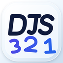
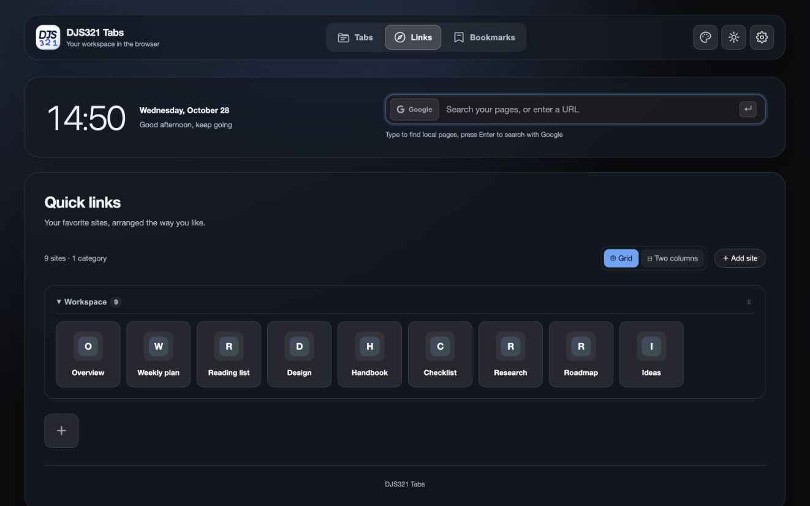
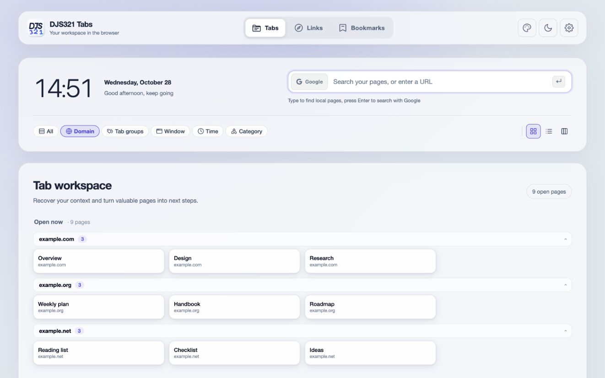

<p align="center">
  
</p>

# DJS321 Tabs

**Less tab clutter. More room to focus.**

A local-first tab manager and new-tab workspace for desktop Chrome and Edge.
Archive pages for later, find your browsing context, and keep useful links within reach.
Core features work without an account or the DJS 321 App.

**English** | [简体中文](README.zh-CN.md)

[](https://github.com/jiuchan/djs321-tabs/actions/workflows/ci.yml)
[](LICENSE)

[Download preview](https://djs321.com/en/#tab-butler-download) · [Installation guide](docs/PREVIEW_INSTALL.md) · [Report an issue](https://github.com/jiuchan/djs321-tabs/issues) · [Changelog](docs/releases/v1.1.0.md)



*Version 1.1.0 desktop layout (16:10), with synthetic demo data. [Screenshot details](docs/images/README.md).*

> **Manual-install preview:** not yet listed or reviewed in the Chrome Web Store or Edge Add-ons.
> There are **no automatic updates**. Desktop Chrome and Microsoft Edge only; not Safari or iOS.

## Why DJS321 Tabs?

| Do less of this | Do more of this |
| --- | --- |
| Keep every page open just in case | Archive tabs, optionally close them, and restore their exact URLs later |
| Hunt through a crowded tab strip | Search open tabs and archives from the popup or new-tab page |
| Lose context between projects | Group by domain, browser tab group, window, time or content category |
| Start every session from scratch | Use quick links, bookmarks, a clock and search in one workspace |
| Get locked into a single view | Choose grid, compact list or board views; top, side or classic navigation |
| Rely on one browser profile forever | Export archives as JSON or Markdown, and back up or restore your data |

Light and dark themes are included. Sending selected pages to a paired DJS 321 desktop App or your
own HTTPS endpoint is optional; local tab management does not depend on either.

### A workspace for open tabs



*Desktop landscape capture of real production components, with sample pages instead of personal browsing data.*

## Install

1. Get the **1.1.0 preview package** from the [official download page](https://djs321.com/en/#tab-butler-download).
2. Extract it into a permanent folder. Keep that folder after installation.
3. Open `chrome://extensions/` or `edge://extensions/` and enable **Developer mode**.
4. Click **Load unpacked** and select the folder directly containing `manifest.json`.
5. Open a new tab, or pin the extension to use its popup.

Installation replaces your new-tab page. A GitHub **source-code ZIP is not an installable package**;
build the source first if you use it. See the [full installation guide](docs/PREVIEW_INSTALL.md).
Managed browsers may block installation; do not bypass your administrator's restrictions.

### Update safely

Export important data from extension settings first. Replace the files **inside the original
installation folder**, then reload the existing extension on the browser's extensions page.
Do not uninstall it first or move the folder: that can change the extension ID or lose local data.

## Language

The interface follows the **browser UI language**, not necessarily your computer's language or the
preferred language for websites. English and Simplified Chinese are supported; other locales fall
back to English. There is currently no independent language selector in the extension.

If a Chinese-language computer shows English, check Chrome or Edge's own interface language,
restart the browser after changing it, and reload the extension. A regular web preview without
the browser extension APIs falls back to English.

## Keyboard shortcuts

| Shortcut | Action |
| --- | --- |
| `Alt+Shift+W` | Archive the current tab and keep it open |
| `Alt+Shift+X` | Archive and close the current tab |
| `Alt+Shift+J` | Send the current tab to the paired DJS 321 desktop inbox |

Change these at `chrome://extensions/shortcuts` or `edge://extensions/shortcuts` if your browser or
operating system already uses them.

## Privacy And Permissions

- Archives and quick links stay in your browser. Some preferences use your browser's sync service.
- There is no DJS321 Tabs account, analytics or telemetry. Local core features need no App login.
- Search submissions go to your chosen engine. Optional online wallpapers and gallery thumbnails
  contact image providers; daily quotes are off by default and contact Hitokoto when enabled.
- Site icons use the browser's local favicon cache rather than an external icon service.
- Page text is captured only on an explicit action. Optional website access is requested per site
  and can be revoked; selected content is sent only when you choose a sending action.
- Optional desktop pairing requires your approval in a compatible desktop App. Credentials stay
  on this device, outside settings sync and JSON backups. iOS does not provide this desktop link.

Installation requests browser permissions for tabs/groups, bookmarks, storage, downloads,
notifications, local site icons, user-triggered page extraction and the localhost App connection.
Read [PRIVACY.md](PRIVACY.md) and the [installation guide](docs/PREVIEW_INSTALL.md) for the exact
permissions, network recipients and data-deletion boundaries. This is local-first, not a promise
that every optional feature is offline.

## Development

Use **Node.js 22** (see `.nvmrc`).

```bash
git clone https://github.com/jiuchan/djs321-tabs.git
cd djs321-tabs
npm ci
npm run build
```

Load the generated `dist/` folder as an unpacked extension. For development, `npm run dev` rebuilds
on changes; reload the extension in the browser when needed.

```bash
npm test
npm run lint
npm run build
```

## Contributing And Support

Bug reports, documentation fixes and focused pull requests are welcome. Read
[CONTRIBUTING.md](CONTRIBUTING.md) and the [Code of Conduct](CODE_OF_CONDUCT.md) first.
Commits require a DCO sign-off (`git commit -s`). Include your browser version, extension version
and reproduction steps when reporting a bug, but do not attach private browsing data.

Report vulnerabilities privately using [SECURITY.md](SECURITY.md), not a public issue.
For support, contact [support@djs321.com](mailto:support@djs321.com).

## License

Source code is licensed under the [Apache License 2.0](LICENSE).
The names "DJS321 Tabs", "倒计时321" and "DJS 321", and the product icons, are not covered by that
license. See [TRADEMARKS.md](TRADEMARKS.md) before reusing the branding.
