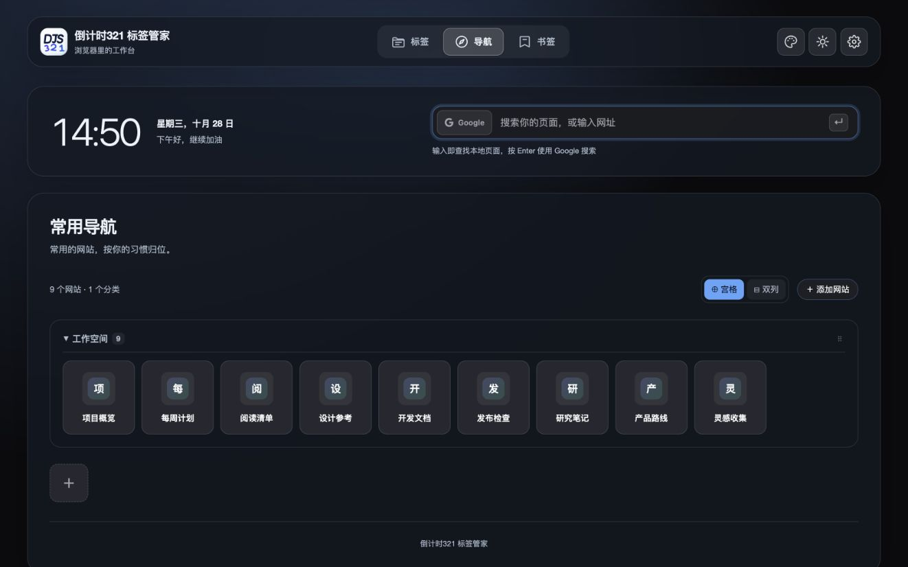

<p align="center">
  
</p>

# 倒计时321 标签管家（DJS321 Tabs）

**少一点标签混乱，多一点专注空间。**

适用于桌面 Chrome 和 Edge 的本地优先标签管理器与新标签页工作台。
归档稍后再看的页面，快速找回浏览上下文，把常用链接放在触手可及的地方。
核心功能无需注册账号，也不依赖倒计时321 App。

[English](README.md) | **简体中文**

[](https://github.com/jiuchan/djs321-tabs/actions/workflows/ci.yml)
[](LICENSE)

[下载预览版](https://djs321.com/zh-Hans/#tab-butler-download) · [安装指南](docs/PREVIEW_INSTALL.md) · [反馈问题](https://github.com/jiuchan/djs321-tabs/issues) · [更新日志](docs/releases/v1.1.0.md)



*1.1.0 桌面横屏界面（16:10），内容为合成示例资料。见[截图说明](docs/images/README.md)。*

> **手动安装预览版：** 尚未上架或通过 Chrome 应用商店／Edge 加载项审核，**不会自动更新**。
> 仅支持桌面 Chrome 和 Microsoft Edge，不支持 Safari 或 iOS。

## 能解决什么问题？

| 原来的困扰 | 可以怎么做 |
| --- | --- |
| 怕丢失页面，只能一直开着 | 归档后选择关闭或保留，之后按原始网址恢复 |
| 标签太多，找不到需要的页面 | 从弹窗或新标签页搜索已打开的标签与归档 |
| 多个项目混在一起 | 按域名、浏览器标签组、窗口、时间或内容分类整理 |
| 每次都要重新找常用网站 | 在工作台集中使用常用导航、书签、时钟和搜索 |
| 一种布局无法适应所有任务 | 标签支持网格、紧凑列表和看板，导航支持顶部、侧边和经典布局 |
| 担心资料被锁在一个浏览器中 | 归档导出为 JSON／Markdown，或备份与恢复全部资料 |

支持浅色和深色主题。发送选定页面到已配对的倒计时321 桌面 App，或你自己的 HTTPS 地址，
都是可选功能；不连接也能独立管理标签。

### 标签工作台


*此图为英文桌面横屏界面。截图使用实际组件与示例页面，不含个人浏览记录。*

## 安装

1. 从[官网下载页](https://djs321.com/zh-Hans/#tab-butler-download)取得 **1.1.0 预览包**。
2. 解压到固定文件夹，安装后保留该文件夹。
3. 打开 `chrome://extensions/` 或 `edge://extensions/`，开启“开发者模式”。
4. 点击“加载已解压的扩展程序”，选择直接包含 `manifest.json` 的文件夹。
5. 打开新标签页，或将扩展固定到工具栏以使用弹窗。

安装会替换浏览器的新标签页。GitHub 的 **Source code 源码 ZIP 不能直接安装**，需要先构建。
完整步骤见[安装指南](docs/PREVIEW_INSTALL.md)。受管理的浏览器可能禁止安装，请勿绕过管理员限制。

### 安全更新

更新前在扩展设置中导出重要资料。替换**原安装文件夹内部**的文件，再到扩展管理页重新加载原扩展。
不要先卸载，也不要更换文件夹路径，否则可能改变扩展 ID 或丢失本地资料。

## 界面语言

扩展跟随**浏览器自身的界面语言**，不一定等于电脑系统语言或网站首选语言。
目前支持英文与简体中文，其他语言回退为英文；扩展内暂时没有独立语言选择器。

如果中文电脑显示英文，请检查 Chrome／Edge 自身的界面语言，修改后重启浏览器并重新加载扩展。
没有浏览器扩展接口的普通网页预览会回退为英文。

## 快捷键

| 快捷键 | 操作 |
| --- | --- |
| `Alt+Shift+W` | 归档当前标签，不关闭 |
| `Alt+Shift+X` | 归档并关闭当前标签 |
| `Alt+Shift+J` | 将当前标签发送到已配对的倒计时321 桌面收件箱 |

如与浏览器或系统快捷键冲突，可在 `chrome://extensions/shortcuts` 或 `edge://extensions/shortcuts` 修改。

## 隐私与权限

- 归档和常用导航保存在浏览器本地；部分偏好会使用浏览器自身的同步服务。
- 无需 DJS321 Tabs 账号，不含分析统计或遥测；本地核心功能不要求 App 登录。
- 搜索会交给所选搜索引擎。可选在线壁纸及图库缩略图会请求图片服务；每日一言默认关闭，启用后请求 Hitokoto。
- 网站图标使用浏览器本地 favicon 缓存，而非外部图标服务。
- 仅在主动操作时提取正文。额外网站权限按站点请求并可撤销，只有选择发送时才传输选定内容。
- 可选桌面连接需在兼容的 App 中确认配对。凭据仅保留在本设备，不进入偏好同步或 JSON 备份；iOS 不提供此桌面连接。

安装时会请求标签／分组、书签、存储、下载、通知、本地网站图标、主动正文提取及 localhost App 连接所需权限。
完整权限、接收方和删除边界见 [PRIVACY.md](PRIVACY.md)（英文）与[双语安装指南](docs/PREVIEW_INSTALL.md)。
“本地优先”不代表所有可选功能都完全离线。

## 开发

使用 **Node.js 22**（见 `.nvmrc`）。

```bash
git clone https://github.com/jiuchan/djs321-tabs.git
cd djs321-tabs
npm ci
npm run build
```

将生成的 `dist/` 文件夹加载为已解压扩展。开发时使用 `npm run dev` 监听并重新构建，按需在浏览器中重新加载扩展。

```bash
npm test
npm run lint
npm run build
```

## 参与贡献与支持

欢迎问题反馈、文档修正及范围明确的 Pull Request。请先阅读 [CONTRIBUTING.md](CONTRIBUTING.md)
和[行为准则](CODE_OF_CONDUCT.md)（英文）。提交需附 DCO sign-off（`git commit -s`）。
反馈问题时请提供浏览器版本、扩展版本和复现步骤，不要附带私人浏览资料。

安全漏洞请按 [SECURITY.md](SECURITY.md) 私下报告，不要直接发布到公开 Issue。
使用问题可联系 [support@djs321.com](mailto:support@djs321.com)。

## 许可证

源代码采用 [Apache License 2.0](LICENSE)。“DJS321 Tabs”“倒计时321”“DJS 321”等名称与产品图标
不在此许可证授权范围内。复用品牌前请阅读 [TRADEMARKS.md](TRADEMARKS.md)。
